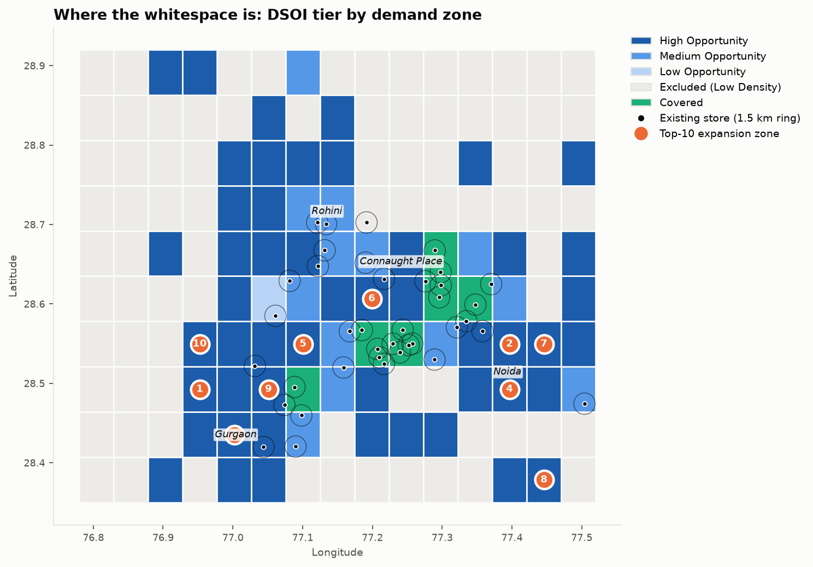
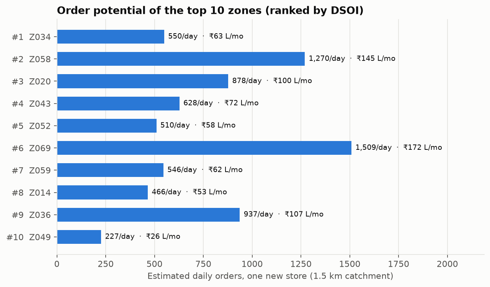
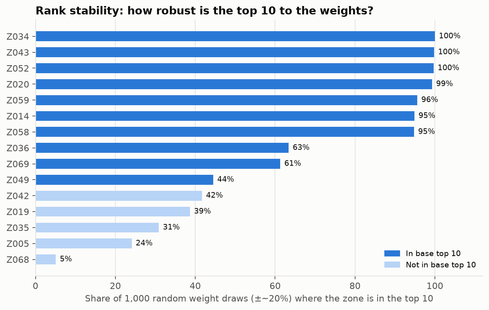
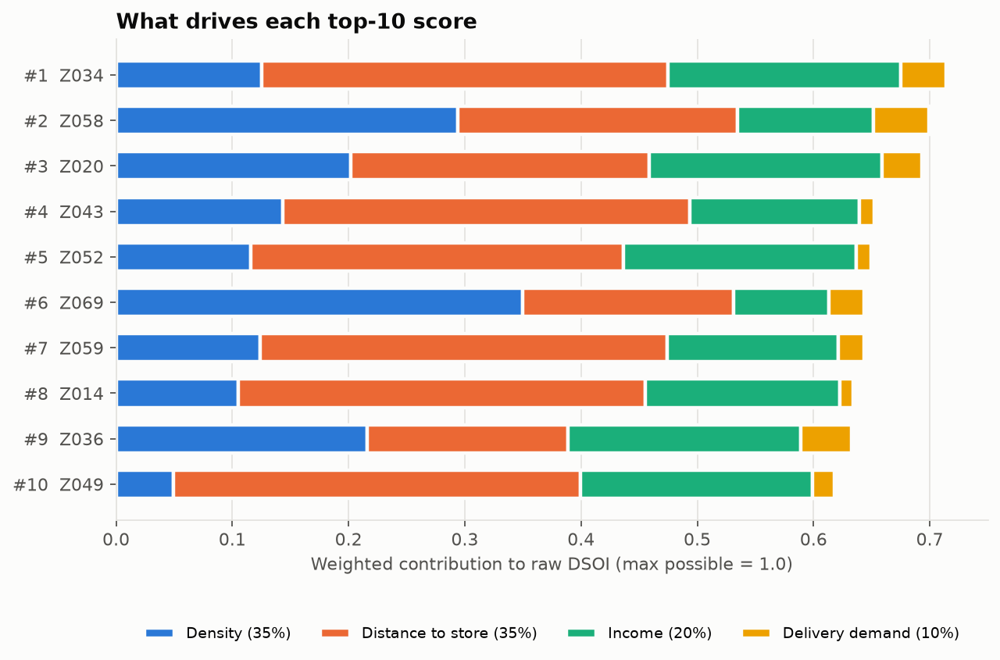
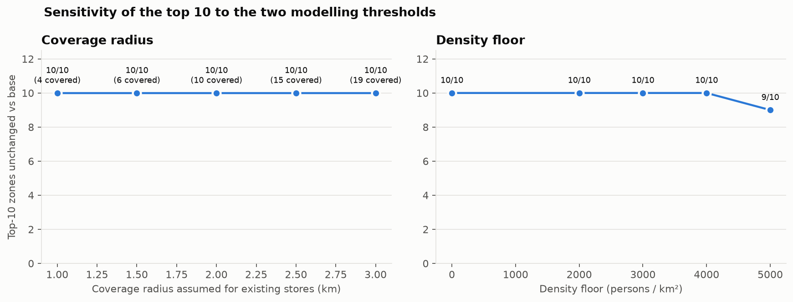
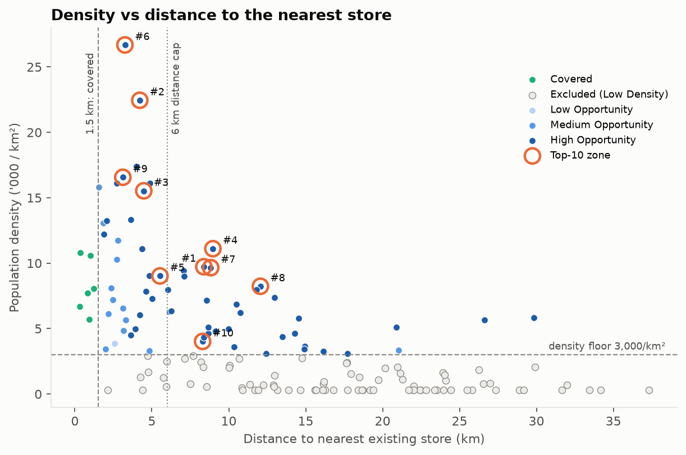
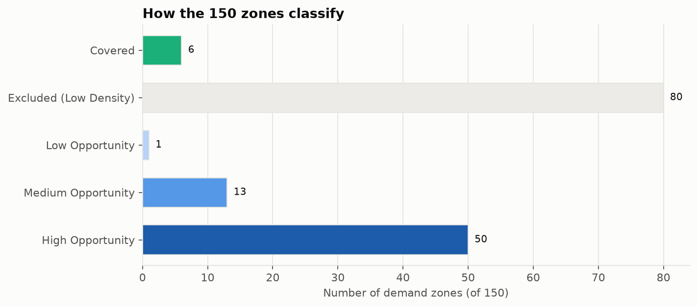

# Dark Store Placement Intelligence (Delhi-NCR)

Where should a quick-commerce operator (Blinkit, Zepto, Instamart) open its next 10 dark stores in Delhi-NCR?
Built in Python (GeoPandas, scikit-learn, Folium, pandera, SQLite). The model scores 150 demand zones on a weighted **Dark Store Opportunity Index (DSOI)**, sizes the order and GMV potential of the top 10, and stress-tests the ranking with 1,000 random weight draws.

**[Open the interactive map](https://htmlpreview.github.io/?https://github.com/Ishaan1000/dark-store-placement/blob/main/outputs/dark_store_opportunity_map.html)** · [Strategy brief (PDF)](outputs/Dark_Store_Strategy_Brief.pdf) · [Excel what-if model](outputs/excel/Dark_Store_Expansion_Model.xlsx)



## Key findings

| | |
|---|---|
| Demand zones scored | 150 |
| Already covered (within 1.5 km of one of 38 existing stores) | 6 |
| Excluded (density below 3,000/km²) | 80 |
| Eligible candidates | **64** (50 High Opportunity) |
| Top 10: est. orders/day (one new store each, 1.5 km catchment) | **7,521** (≈752 per store) |
| Top 10: est. GMV | **₹8.6 Cr / month · ₹104 Cr / year** |
| Top-10 zones kept in the top 10 in ≥90% of 1,000 weight draws | **7 / 10** |

**Top 10 expansion zones**

| # | Zone | Type | Nearest store (km) | Density /km² | DSOI | Orders/day | GMV ₹L/mo | Stable* |
|---|---|---|---|---|---|---|---|---|
| 1 | Z034 | Urban | Blinkit Palam Vihar (8.4) | 9,727 | 100.0 | 550 | 63 | 100% |
| 2 | Z058 | Metro Core | Zepto Noida Sec 44 (4.2) | 22,451 | 97.9 | 1,270 | 145 | 95% |
| 3 | Z020 | Metro Core | Zepto Sohna Road (4.5) | 15,532 | 97.1 | 878 | 100 | 99% |
| 4 | Z043 | Metro Core | Zepto Noida Sec 44 (9.0) | 11,108 | 91.3 | 628 | 72 | 100% |
| 5 | Z052 | Urban | Zepto Dwarka Sec 10 (5.5) | 9,026 | 90.9 | 510 | 58 | 100% |
| 6 | Z069 | Metro Core | Blinkit Connaught Place (3.2) | 26,680 | 90.1 | 1,509 | 172 | 61% |
| 7 | Z059 | Metro Core | Zepto Noida Sec 44 (8.8) | 9,659 | 90.0 | 546 | 62 | 96% |
| 8 | Z014 | Urban | Blinkit Greater Noida (12.1) | 8,236 | 88.8 | 466 | 53 | 95% |
| 9 | Z036 | Metro Core | Blinkit Gurgaon Sec 29 (3.1) | 16,566 | 88.6 | 937 | 107 | 63% |
| 10 | Z049 | Urban | Blinkit Palam Vihar (8.3) | 4,023 | 86.5 | 227 | 26 | 44% |

\*Stable = the share of 1,000 random weight draws (each weight moved by about ±20%) in which the zone stays in the top 10.

**Sensitivity** (`outputs/sensitivity_*.csv`)
- **Weights:** the median random draw keeps 9 of the 10 zones. Named distance-, income-, density-heavy and equal-weight scenarios keep 8–9.
- **Coverage radius:** any value from 1.0 to 3.0 km leaves the top 10 unchanged.
- **Density floor:** any value from 0 to 4,000/km² leaves the top 10 unchanged. A 5,000/km² floor swaps out only Z049.

**So what:**
- DSOI finds *whitespace*, but whitespace is not the same as volume. Z069 (DSOI rank 6) has the most orders (1,509/day) and Z049 (rank 10) the fewest (227), because the 35% distance weight lifts remote, affluent but thinner zones.
- The recommended first wave is **Z058, Z020 and Z043**: the highest-volume zones among those that are stable under weight changes. Together they come to about 2,800 orders/day and ₹3.2 Cr GMV/month.
- Z069 and Z036 are only about 3 km from existing stores and change rank with the weights. They point to adding capacity at the nearby store, not to opening a new site.




## Data: what's real vs synthetic
| Dataset | Status | Detail |
|---|---|---|
| Existing dark store locations | **Real names, hand-built list** | 38 named Blinkit/Zepto/Instamart locations (`data_loader._fallback_dark_stores`). A live OpenStreetMap query is optional (`DARK_STORE_USE_OSM=1`). It is off by default so every run is reproducible. |
| Demand-zone density, income proxy, delivery demand | **Synthetic** | A parametric multi-centre model (`generate_demand_grid`, seed 42) calibrated to Delhi-NCR geography (CP, Gurgaon, Noida, Rohini). It is not sourced from the Census. |

This is a methodology demonstration. To make it production-grade, swap in a real store roster and ward-level population and income data, then re-run. The scoring and reporting code doesn't change.

## Method
```
DSOI = 0.35 × density + 0.35 × distance to nearest store (capped at 6 km)
     + 0.20 × income proxy + 0.10 × delivery-demand proxy      (each min-max scaled)
```
- Zones within 1.5 km of a store are tagged **Covered**. Zones below 3,000/km² are tagged **Excluded**. Both get DSOI = 0.
- Distances are computed in UTM 43N (EPSG:32643).
- **Order sizing** counts the residents inside one new store's 1.5 km radius (7.07 km²) × 8 orders per 1,000 per day (income ≥ 0.6, otherwise 4) × ₹380 basket. The whole-cell figure (32,471/day) is reported only as a ceiling.

Full detail: [`docs/methodology.md`](docs/methodology.md).

## Fixes made in this version
- **Tier labels:** earlier output labelled all 86 zero-score zones "Covered". Only 6 are actually within 1.5 km of a store; the other 80 were excluded by the density floor. They now have separate tiers.
- **GMV sizing:** earlier output assumed each new store serves its entire ~34 km² grid cell (36,530 orders/day, ₹41.6 Cr/month). Sizing to a 1.5 km catchment gives 7,521/day and ₹8.6 Cr/month.
- **Cell area:** areas were computed as degrees × 111 km, ignoring that a degree of longitude shrinks with cos(latitude), which overstated them by ~14% (34.3 vs 30.5 km²). Areas are now measured in UTM 43N. Headline orders, GMV and the top 10 are unchanged (they use the 1.5 km catchment). The whole-cell ceiling falls from 36,530 to 32,471 orders/day.

## Run
```
python -m venv .venv && .venv\Scripts\activate
pip install -r requirements.txt
python src/run_all.py      # ~30 s: ETL -> validate -> SQLite -> model -> sensitivity -> all outputs
```

| Output | What it is |
|---|---|
| `outputs/dark_store_opportunity_map.html` | Interactive Folium map: zone tiers, store radii, ranked top-10 pins with order/GMV popups |
| `outputs/Dark_Store_Strategy_Brief.pdf` | Two-page brief: KPIs, findings, top-10 table, map, charts |
| `outputs/strategy_brief.md` | Long-form consulting memo |
| `outputs/excel/Dark_Store_Expansion_Model.xlsx` | What-if model: edit basket size, order rates, radius or ramp-up on `Inputs` and the `Top10` formulas recalculate |
| `outputs/figures/*.png` | 7 charts (map, orders, score decomposition, rank stability, threshold sensitivity, tiers, density vs distance) |
| `outputs/*.csv`, `outputs/dark_store.db` | Scored zones, top 10, demand estimates, sensitivity tables; SQLite with a `pipeline_runs` audit table |
| `outputs/data_quality_report.md` | pandera validation summary |

## Charts





## Repository
```
src/
  data_loader.py        store seed list + synthetic demand grid
  schemas.py            pandera data contracts
  pipeline.py           extract -> validate -> transform -> load (SQLite)
  opportunity_model.py  coverage, DSOI scoring, top 10, order/GMV sizing
  analysis.py           sensitivity, figures, Excel model, PDF brief
  visualizer.py         interactive Folium map
  run_all.py            one-command entry point
notebooks/              01-04 exploratory walk-through
docs/methodology.md
outputs/
```

## Author
**Ishaan Mankotia** · [GitHub](https://github.com/Ishaan1000)

MIT License
